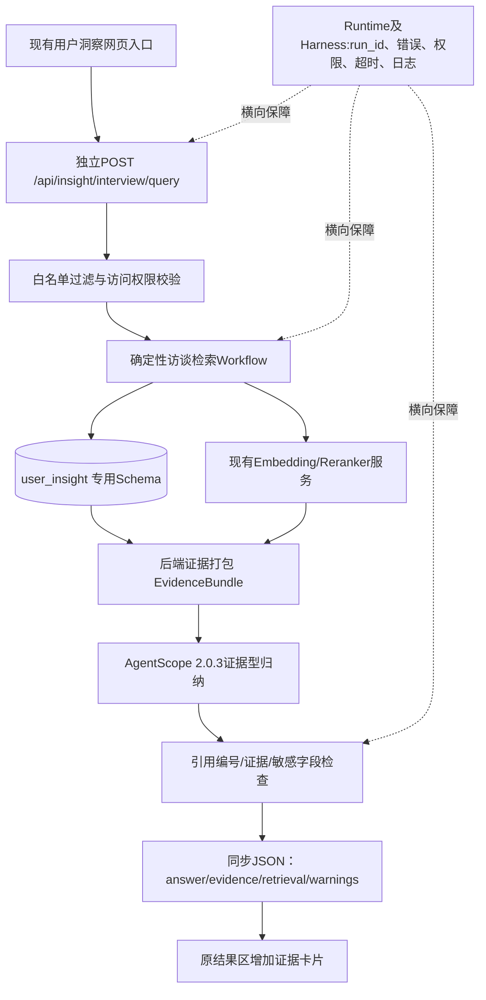

# TRAE 专用｜乘用车用户洞察 AI 智能体开发指南 V3.1

**版本日期：** 2026-10-30  
**定位：** 现有 AgentScope 2.0.3 网页项目上的轻量用户洞察纵向开发  
**分工：** TRAE 主责用户洞察；Codex 主责市场战略；预测功能保持不变  
**当前任务：** T0 只读复核已有审计、数据契约与 CATARC 工程规范适配，禁止直接修改业务代码。  
**不涉及：** 经费采购、全站重构、从零构建数据集、现阶段新增微调训练。  

> “参考优秀案例”不是复制 CATARC 代码、服务、端口或依赖，也不是为本项目安装 CATARC。只复用经过验证的工程理念：SSOT、Stage Contract、Hard Gate、Checkpoint、Provenance、Verify、跨工具协作。

## 0. 参考来源与适用范围

| 参考源 | 优先学习什么 | 采用方式 |
|---|---|---|
| 现有项目实际源码 / 数据库 | 当前真实实现、兼容接口和副作用 | **第一优先级的实现事实**，只读复核 |
| 《用户洞察智能体_代码审计与MVP开发方案_20261030.md》 | AgentScope 2.0.3、ThreadingHTTPServer、工具注册、同步API、数据库和风险 | T0 复核现状；不是替代源码 |
| 《用户洞察智能体_接口契约_20261030.md》 | 请求/响应、白名单过滤、`[E#]`证据引用 | 已有协议设计基线，冲突先出清单 |
| 《用户洞察智能体_访谈Schema_20261030.sql》 | `user_insight` 7张表 | 设计基线；T0不得执行DDL |
| 数据底座 `README`、manifest、checksum、实际数据 | 受访者、问答、标签、证据的**实际版本与计数** | 只在授权内网核验；先清理口径冲突 |
| 同事的私有 CATARC 项目 `AGENTS.md`、`PROJECTS.md` | 项目隔离、真源指针、协作边界、结束验收 | 学习约束方法，**不要复制目录** |
| CATARC `industry-tracking-v2/WORKFLOW.md` | 启动、运行、停止、恢复、人工操作与验收 | 参考运行手册结构，不复制采集业务流程 |
| CATARC `industry-tracking-v2/docs/HARNESS.md` | Stage Contract、Hard Gate、Provenance、成本与状态 | 实现用户洞察领域对应规则 |
| CATARC `config/tracking_v2_protocol.json` | 机器可读的阶段/状态/硬门契约 | 后续按必要性实现轻量JSON/Pydantic契约 |
| CATARC `scripts/verify_harness.py` | 隔离测试库、独立输出、结构和业务端到端验证 | **优先借鉴**：测试不能污染正式库 |
| 《CATARC 工程实践借鉴与现有网页智能体架构优化指导书 V1.1》 | 责任边界和渐进式改造原则 | 作为参考规范，不覆盖用户洞察自身接口契约 |

**私有仓库：** `https://github.com/2388976762yu-hash/CATARC`。TRAE如无明确授权的本地副本或访问权限，只读取本指南中的借鉴摘要；不得自行使用账户凭据克隆或批量下载资料，也不得把任何私有源码、凭据、数据复制进本项目。

**真源不混用：** CATARC 属于“汽车产业动态跟踪”范例；本项目是真实用户访谈证据与用户研究分析。CATARC 的新闻抓取、搜索Provider、行业政策库、SQLite表族和发布硬门不移植到用户洞察。

## 1. 统一实施结论

1. **保留现有网页与AgentScope 2.0.3**，不重构全站，不引入LangGraph/Temporal或另一套Agent框架。
2. **现有Web服务是`http.server.ThreadingHTTPServer`，不是FastAPI**；第一阶段新增独立路由/分支并兼容原API，暂不迁移框架。
3. **现有网页是同步POST返回JSON，不存在真实SSE**；第一阶段先完成同步接口`POST /api/insight/interview/query`，SSE属于后续T5+增强项。
4. 现有用户洞察Agent使用`Agent + ReActConfig + Toolkit`、`ReadOnlyBusinessTool`；现有`user_insight_tagger`只是关键词/规则打标，不能冒充可追溯访谈证据。
5. 现有`SkillRunContext`包括run-state/任务图/checkpoint机制，但不等于用户洞察现成Workflow；当前后端还有Job Manager等能力，需复核**能否复用**，不立即建设新Runtime。
6. 现有RAG/pgvector、Embedding、Reranker主要在**独立旧工程**，当前网页用户洞察Agent尚无访谈检索工具、尚未接WeKnora。首期用专用`user_insight` schema接结构化访谈，不复用`public.chunks`存逐题证据。
7. 使用**确定性检索优先**：接口校验→白名单过滤→向量召回→rerank→按证据源取原文→证据打包→AgentScope仅做受约束的总结→后端引用校验→同步页面证据卡片。不能依赖LLM随机决定是否检索。
8. **首个业务示范为战胜战败/购车决策链证据问答**；保留定性、定量、群体比较、配置分析四类长期专业Skill方向。
9. 已有微调与数据集评测成果作为**离线标签初标及模型评测的候选**，不作为首期在线问答依赖；不重新转写已有合规结构化数据。

## 2. 已有资源与必须核实的材料

### 2.1 资料目录

- `README(1).md` / 原数据包`README.md`：声称63名受访者、85题、5,355条问答、81,437条可检索证据、5,355条标签、45,244条标签证据、定量1380×1324。
- `用户洞察智能体_代码审计与MVP开发方案_20261030.md`：记录本地真实Web/Agent/RAG状态；其中“标签证据明细”写作25,073条、原JSON片段77,380条、去重后77,159条。
- `用户洞察智能体_访谈Schema_20261030.sql`：PostgreSQL `user_insight` schema，7张业务表。
- `用户洞察智能体_接口契约_20261030.md`：同步查询API、SSE二期、Run状态、引用校验。
- `数据集评测第二批启动研讨会_汇报.html`：战胜战败、决策链、标签抽取、微调和先行看板的汇报材料，不等同于当前网页已集成能力。
- 数据包真实`manifest.json`、`coverage_matrix.csv`、`data_quality_report.md`、`SHA256SUMS.txt`、`qa_pairs.csv`、`answer_evidence.jsonl`、`tags.csv`、`tag_evidence.csv`、`2025定量数据汇总.xlsx`：仅在已获授权的本地工作区查验，不假定已附在对话中。

### 2.2 必须明确处理的数量与口径差异

| 对象 | README记载 | 审计报告记载 | TRAE动作 |
|---|---:|---:|---|
| 结构化问答 | 5,355 | 5,355 | 确认63×85、键唯一 |
| 可检索答案证据 | 81,437 | 原JSON 77,380；去重77,159，另2位DOCX回退 | 按来源、去重、是否含回退区分统计，不混用分母 |
| 标签证据明细 | 45,244 | 25,073 | 读取manifest及实际文件计数、说明版本/定义差异；未经核实不覆盖 |
| 标签 | 5,355 | 5,355 | 核对tag_id唯一性/83或85题映射与状态 |
| 定量样本 | 1,380×1,324 | 1,380×1,324，双表 | 核实数字版/中文版字段对应，不在首期做全量计算 |

这类差异属于**验收阻断前置项**：不能为了让数字好看而重写来源文件。以实际已授权数据包的版本、manifest与可复现统计结果为准；若无法获得实体文件，只写“待核实”。

### 2.3 证据定位强约束

- 61名受访者据资料具有带秒级时间的结构化JSON，另2名只有DOCX段落级回退；实际覆盖仍需导入后逐条检验。
- `time_precision=second`才允许显示有效`start_sec/end_sec`和秒级音频跳转；`paragraph`展示段落定位，秒数字段必须为空；`none`显示无法精确定位。
- `source_label`、真实姓名、电话、数据库凭据和原始文件夹名不得返回模型或页面。
- 访谈标签的`trust_status`或模型`confidence`不等于准确性已经通过科学验证；关键结论需可复核证据。
- `answer.evidence`与`tag_evidence`属于不同证据来源，不强制合并；未能关联的标签证据应保持未关联状态并进入核查清单。

## 3. 架构职责及当前工程映射

| 层级 | 业务职责 | 当前工程情况/处理方式 |
|---|---|---|
| Web UI | 研究提问、回答、证据卡片 | `legacy_workbench.html`现有结果区局部增加证据，不改布局 |
| Agent / Orchestrator | 研究意图、提示词、基于证据归纳 | `agents/user_insight_agent.py`现有AgentScope 2.0.3，新增“证据型问答”隔离路径 |
| Workflow | 阶段顺序、分支、校验、复合任务 | 首期确定性Python服务链，之后扩展定性/定量/联合分支 |
| Skill | 业务方法：定性、定量、群体比较、配置 | 首期只实现定性证据检索/战胜战败解释，其他Skill后续 |
| Tool | 输入输出契约，执行受控能力 | 复用`ReadOnlyBusinessTool`+`Toolkit`，新增`interview_evidence_search` |
| Runtime | 任务执行、异步Runner、状态、接口事件 | 现有`AgentEventLoopRunner`、`AGENT_RUN_LOCK`、`SkillRunContext`；首期同步Query |
| 运行期Harness | 参数/权限、超时、日志、证据质量 | 先在接口和检索服务埋最小强制校验与run_id，后续Checkpoint/SSE |
| 开发期Harness | TRAE范围控制、进度、测试、Git | 复用现有文件；不足才补`AGENTS.md`、`plan.md`、`verify.ps1` |
| 数据 | interview/question/answer/evidence/tag/tag_evidence/retrieval_run | 首期新`user_insight` schema，明确不改`public.documents/chunks` |

### 3.1 MVP同步调用链

**重要：** 可以注册新的AgentScope Tool以复用现有能力入口，但首期应由服务端**强制执行确定性检索**，AgentScope不得绕过检索直接给出“用户原话”。

### 3.2 后续扩展路径（本轮不开发）

- 在线统一Workflow：输入→变量/数据检查→任务路由→定性/定量/群体比较/配置分支→Hard Gate→研究归纳→报告。
- 离线加工Workflow：数据新增时才运行ASR→85题问答切分→标签初标/规则判定→时间证据对齐→人工复核→版本入库。
- Runtime：当前同步请求验证成功后，再评估真实任务状态API、SSE流式事件及Checkpoint持久化；不复用“看起来有进度动画”的UI作为真实状态。
- Harness：开发期规则保持最小，运行期质量门禁在每个业务阶段实施，后续共享给市场战略与预测但须共同评审。

## 4. 数据库与证据契约：直接采用已有SQL/接口基线

### 4.1 7张表

`user_insight.interview`、`question`、`answer`、`evidence`、`tag`、`tag_evidence`、`retrieval_run`。

必须先检查SQL与现有数据版本/目标库兼容性；T0禁止执行DDL。T1/T2经审核后方可在隔离的数据库或专用schema按迁移计划执行。

### 4.2 审核时需补充的最小约束（不要先修改原SQL）

1. `evidence`表的`answer_id`、`interview_id`、`question_id`同时存在，但当前DDL未保证三者一定来自同一条回答；导入时须交叉核验，必要时设计复合FK或校验触发器。
2. DDL允许`time_precision=second`而`start_sec/end_sec`都为空；建议在数据库约束或导入校验中保证秒级证据有合法时间，段落级证据不能被显示为秒级。
3. `retrieval_run.question`储存完整问题可能含个人信息；评估脱敏、存储权限、保留期限或改存摘要/哈希，日志不记原话。
4. `evidence_id`在数据库是稳定主键，`[E1]`是**一次检索内的展示编号**。API应保留二者映射并在后端引用校验，不将`E1`当作全局证据主键。
5. 数据源、导入批次、embedding模型和生成时间应可追溯；数据迁移需可逆、可重复，不覆盖旧RAG表。

### 4.3 API契约（已有草案，不能随意改名）

第一阶段：`POST /api/insight/interview/query`。

- 请求：`question`（1—2000字）、白名单`filters`（city、vehicle_model、purchase_type、question_ids、tag_names、tag_values、respondent_codes）、`top_k`（1—12，默认8；如实际限制取更小，需统一文档、后端与UI）、可选`session_id`占位。
- 响应：`run_id`、`status`、`agent`、`answer`、`evidence[]`、`retrieval`、`tool_events[]`、`warnings[]`。
- 后端生成原文和证据列表，LLM只引用后端分配的`[E1]..[En]`。
- 无证据：200 + `status=completed` + 空`evidence[]` + 明确“无可支持原话”。
- 检索依赖故障：受控503/504，不用模型常识顶替。
- 页面只在用户洞察结果区域追加证据卡片，保留原市场战略/预测API和页面布局。

第二阶段：`POST /api/insight/interview/stream`、`GET /api/insight/runs/{run_id}`；**当前项目不存在SSE，此项不能列为首期必验。**

## 5. MVP技术实施任务（TRAE）

| 任务 | 内容 | 技术/文件定位（待复核） | 核心验收 |
|---|---|---|---|
| T0 | **已有审计复核**：核对源码、文件、版本，解决数据计数口径、接口冲突，输出差异清单 | 只读，不写库不改源码 | 能指出审计结论仍有效/已变化/无法验证 |
| T1 | 最小开发期Harness+协作边界 | AGENTS.md、plans、Git分支/worktree、Windows测试入口 | 非用户洞察模块零意外变更；市场/预测回归基线 |
| T2 | 数据版本固定及独立Schema/导入 | 既有interview SQL + 导入脚本 + pgvector | 63×85、证据来源/时间精度、PII隔离可审计 |
| T3 | 检索服务和AgentScope Tool | services/interview_retrieval_service.py、tools/interview_retrieval.py | 过滤、召回、rerank、证据回源、降级及无结果 |
| T4 | 独立同步API+网页证据卡片 | app.py独立路由、user_insight_agent.py隔离分支、legacy_workbench.html局部 | 网页真实问答闭环；旧API和UI回归 |
| T5 | 战胜战败决策链专题Skill | 问题-标签-证据映射、结构化归因 | 原因结论逐条有证据，不能强因果推断 |
| T6 | 定量问卷统计与用户群体差异 | 变量字典、受控SQL/Python、数据契约 | 统计与人工核对一致，分母透明 |
| T7 | 配置建议及联合洞察 | 各Skill结果组合、数据可比性检查 | 结论区分样本结果与研究假设 |
| T8 | SSE/Checkpoint/运行期Harness增强 | AgentScope reply_stream、持久化状态与阶段门禁 | 不破坏原同步API；故障可追踪可恢复 |

这里T0仅做复核和差异报告；TRAE不能以“工程清理”为由自行执行T1-T8。

## 6. 双开发工具协作（TRAE与Codex）

- TRAE拥有用户洞察新增模块、用户洞察Agent和专属结果区扩展；Codex拥有市场战略Agent及其相关Skills。
- 对`app.py`、`tools/custom_tools.py`、`legacy_workbench.html`、共享AgentScope初始化、共享数据库连接层等文件，先标记为**共同影响文件**。TRAE可以提出最小patch，但实施前必须评审接口兼容性和Git差异。
- 推荐独立Git分支/worktree；若只能共用同一个工作目录，必须保证同一时段不并发修改同一共享文件，且每次工作前检查`git status`。
- 不允许覆盖/清理Codex未提交的改动、自动格式化全仓或修改市场预测服务。
- 先保证现有`POST /api/chat`和`POST /api/assistant/chat`及各预测/报告接口不受影响。

## 7. 质量门禁与基本测试

- 数据检查：63×85、有效题号、`answer_id`唯一、时间精度、证据哈希、未关联的标签证据记录。
- 检索检查：筛选城市/车型后不串数据；被检索文档中恶意提示词不得成为系统指令；失去Reranker时清晰降级。
- 引用检查：正文的每个`[E#]`必须存在于本次`evidence[]`；任何引用必须对应数据库原文；无证据不生成用户原话。
- API检查：非法筛选字段、空问题、越界top_k、无结果、依赖超时、权限不足。
- 安全检查：响应、模型输入、日志中不得泄露内部`source_label`、姓名、电话、密钥。音频时间戳缺失不得补造。
- 回归检查：`/api/chat`、`/api/assistant/chat`、市场战略/预测接口、首页和原导航行为不变化。
- 测试必须给出实际执行命令与结果；没有可接入的真实受控数据时，允许单元测试用合成数据，但**不能把模拟测试称为真实业务验收**。

## 8. 最终里程碑

首个“成功”不是AI给出一段流畅回答，而是：

**网页真实提问 → `POST /api/insight/interview/query` → 受控检索结构化访谈 → AgentScope基于证据回答 → 后端引用核验 → 页面显示脱敏原话、题号、时间精度与证据卡片。**

任何步骤缺少真实数据、证据回源或回归验证，都只能标记为局部开发完成，而不是MVP闭环通过。

## 9. CATARC优秀实践：映射到本项目的最小闭环

### 9.1 把工程规范转换成真正可执行的规则

| 借鉴机制 | 用户洞察版本 | 首期实现级别 |
|---|---|---|
| 项目隔离 / SSOT | `AGENTS.md` 路由至用户洞察计划；Schema和API各自唯一维护；TRAE不写市场战略/预测 | T1必须 |
| Workflow 与 Stage Contract | `validate_request -> retrieve -> pack_evidence -> synthesize -> verify -> respond`，每阶段有输入/输出/失败状态 | T2-T4必须 |
| Hard Gate | 白名单过滤、PII屏蔽、引用存在、来源校验、秒级/段落级精度约束、无证据不编造 | T2-T4必须 |
| Provenance | 数据版本、稳定`evidence_id`、源hash、`run_id`和审计元数据；不在普通日志记原文 | T2-T4必须 |
| Verify | schema/导入/过滤/回源/API/UI/市场预测回归，隔离测试数据 | T1开始逐步完善 |
| Checkpoint | 首期用现有`retrieval_run`和运行日志；多阶段长任务再评估Job Manager/SkillRunContext复用 | T8后增强 |
| Budget / Cancellation | 单次工具调用超时、最大调用数；长任务才设计取消和恢复 | 首期最小限制 |
| 真实接线 | `evidence[]`真实从数据库生成；引用号后端校验，网页不能拿演示定时进度冒充真实工作流 | 首期必须 |

### 9.2 不做的事情

- 不因为CATARC有专门的API服务和后台Job，就把当前同步用户洞察查询强行改为异步作业。
- 不安装独立运行时框架，也不把旧`agentscope-runtime`当作必要依赖。
- 不将`WORKFLOW.md`等价于可执行Workflow；文档说明方法，Python代码实际控制执行。
- 不复制CATARC的数据库结构、模型供应商配置、抓取脚本、限额数字或业务规则。
- 不把CATARC根目录的多项目路由体系套进当前单个`myproject`；沿用当前项目已存在的规则文件，缺失时只增加最小指针。
- 不把Git commit当作数据授权；未经审批，真实用户访谈数据与个人信息不得发送到TRAE云模型或远端仓库。

### 9.3 用户洞察MVP阶段契约建议

| Stage | 输入 | 程序执行者 | 输出 | Hard Gate |
|---|---|---|---|---|
| validate_request | question/filters/top_k + 已认证用户 | HTTP路由 + Pydantic/规则 | CleanQuery | 不允许任意SQL/字段和跨授权访问 |
| retrieve_answers | CleanQuery、数据版本 | Python PostgreSQL/pgvector 检索 | AnswerCandidates | 仅真实数据库记录；筛选条件不串样本 |
| rank_evidence | 候选答案 + Reranker | 检索服务 | EvidenceCandidates | 失败可降级但必须标记 |
| pack_evidence | 数据库证据、来源版本 | Python | EvidenceBundle + `E1..En`映射 | 源hash和时间精度一致；不暴露姓名 |
| synthesize | 限定证据包 + 专项Prompt | AgentScope 2.0.3 | DraftAnswer | 无证据只能受限回答 |
| verify_answer | DraftAnswer + EvidenceBundle | Python规则 | VerifiedAnswer + warnings | 不存在的引用不得出现在最终答复；不编造原话 |
| respond | VerifiedAnswer | HTTP/API/UI | JSON + 证据卡片 | 保留现有市场/预测协议不变 |

建议每一阶段返回最少：`run_id`, `stage`, `status`, `input_version`, `output_ref`, `duration_ms`, `error_code`（敏感文本不写普通日志）。采用Pydantic模型或与现有代码等价的结构约束，**不以新增一个大JSON协议文件为目标**。

### 9.4 统一工程使用规范（TRAE日常工作）

1. **开工**：先读现有仓库规则、当前计划和Git状态，识别用户洞察专属文件及共享影响文件。
2. **计划**：一个小任务只改变一个可验收业务行为；列出受影响文件、测试、风险和回滚方式。
3. **编码**：用户洞察专属业务模块可按任务推进；对`app.py`/`legacy_workbench.html`等共享文件必须先提交最小差异方案。
4. **验证**：自动化测试至少涵盖非法输入、无结果、引用一致性、秒级/段落级、降级和既有功能回归。
5. **收工**：报告具体文件、实际执行的测试、未完成问题，并更新**已有**任务进度真源；不新建平行“会话日志”。
6. **协作**：优先Git独立分支或worktree。Codex/TRAE不能同时修改同一共享文件；不得覆盖他人未提交改动。
7. **停止条件**：同一错误有效修复尝试达到3轮仍失败、身份授权不清、关键数据口径冲突无法核实、共享文件并发写冲突，停止并报告，不扩大修改范围。

### 9.5 按阶段实施，不额外搭建新平台

- **T0（当前）**：只读核验源码、3份接口/Schema/审计基线与数据差异；评估CATARC做法的可复用/不适用。
- **T1**：仅在缺少时补开发期Harness（现有AGENTS入口、计划与状态真源、Windows `verify.ps1`、pytest）。
- **T2—T4**：真正实现最小Workflow及运行期Harness：检索 → EvidenceBundle → 受约束归纳 → 引用Hard Gate → 同步JSON → 证据卡片。
- **T5—T7**：基于真实证据发展战胜战败、定量、群体比较、配置建议Skill。
- **T8**：确认复杂长任务需要后，再引入真实运行进度、可恢复Checkpoint、SSE、取消与限额细分。

**整体完成标准：** 不只验证HTTP 200或能出一段报告，还必须核对数据版本、引用源、业务统计边界、脱敏和市场/预测功能回归。

