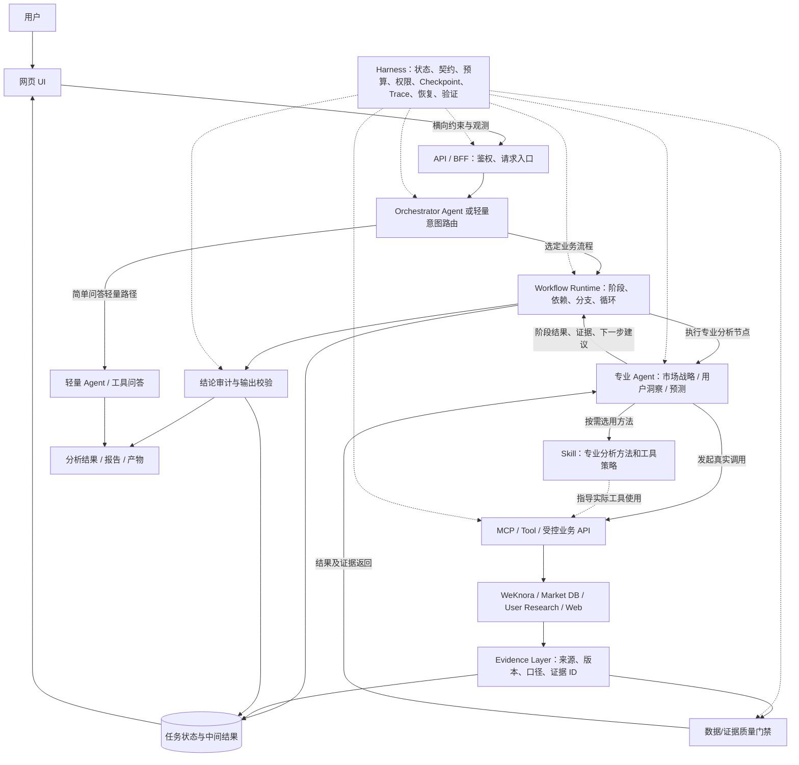
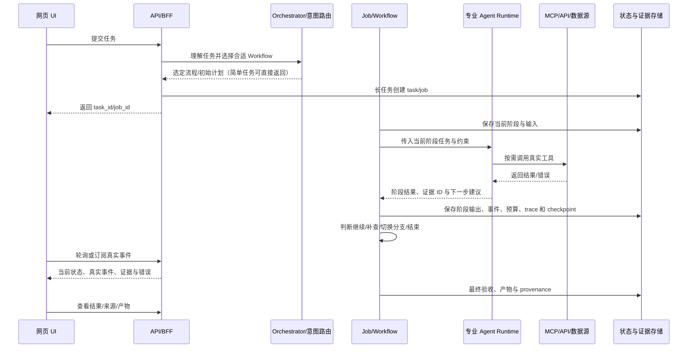

# CATARC 工程实践借鉴与现有网页智能体架构优化指导书

> **用途：** 交给 Codex，作为研究 CATARC、审计现有乘用车市场战略 AI 网页智能体、制定并分阶段实施架构优化的工作指导。  
> **核心原则：** 学习 CATARC 的工程思想，不照搬其业务代码；先核实现状，再设计方案；保留已有有效成果，渐进式改造。  
> **版本：** V1.1 · **原始整理：** 2026-10-18 · **架构原则修订：** 2026-10-20  
> **参考仓库：** [2388976762yu-hash/CATARC](https://github.com/2388976762yu-hash/CATARC)（私有仓库，访问需要授权）

### V1.1 修订说明（务必优先遵守）

本版根据用户对架构职责与调用方向的校正进行了全文一致性修订：

- **Workflow 是业务执行流程的编排责任方；Harness 是横向保障体系，不是固定调用节点。**
- **入口层可以由 Orchestrator Agent 识别意图并选择 Workflow；运行中由 Workflow Runtime 调度专业 Agent，专业 Agent 再把结果和下一步建议返回 Workflow。** 这种双向协作不是矛盾，而是“流程选择”和“流程执行”两个不同层次。
- **`WORKFLOW.md` 是面向人或开发 Agent 的操作文档，不等于自动运行的 Workflow Engine；`HARNESS.md` 是设计契约，不等于 Harness 的全部实现。**
- 目标架构是对**现有网页智能体的建议**，不能误称为 CATARC 已实现了同样的 Orchestrator → Workflow → 多 Agent 链路。CATARC 的后端可在没有对话 Agent 参与的情况下独立执行其业务流水线。
- Skill 可以由 Agent 选择，也可以由 Workflow 在规定节点调用；MCP/Tool 是实际能力接口，**不强制每次工具调用先经过 Skill**。

如全文其他示意图、历史描述与下文「第 3 章权威职责定义」矛盾，**以第 3 章和第 6 章 V1.1 目标架构为准**。

---

## 0. 给 Codex 的执行要求（请先阅读）

你的任务不是把 CATARC 代码复制到当前项目，也不是为了引入 Harness 而重写系统。你需要：

1. 研究 CATARC 的真实工程实现，重点看 `AGENTS.md`、`WORKFLOW.md`、`HARNESS.md`、机器可读协议、Pipeline/Job/Checkpoint/Gate/Verify 代码、Skill 和 MCP 实现。
2. 审计当前工作区的网页智能体，确认它如何接收请求、选择 Agent、调用 Skill/Tool/MCP、访问 RAG/数据库/网络、生成结果和呈现进度。
3. 区分真实能力与界面占位：按钮、日志、进度条、Skill 标签或 MCP 卡片的存在，不等于后端真实实现了对应功能。必须沿代码调用链验证。
4. **先给出证据充分的现状诊断和分阶段方案，再实施较大范围改造。** 不得在未盘点项目、未保存验证基线前直接重写。
5. 保留已有可用模块，优先复用现有 AgentScope/模型服务/RAG/PostgreSQL/pgvector/工具代码；不要为了追求架构“先进”而无必要地引入新框架。
6. 保持动态 Agent 能力：不能把所有业务问题硬编码成同一套固定步骤。确定性程序负责安全、状态、预算、数据校验和验收；Agent 根据任务、证据缺口和冲突动态规划、选择工具、调整下一步。
7. 结论尽量提供文件路径、函数/类/接口名、调用关系和验证结果。找不到证据时标记“待确认”，不能猜测。
8. 修改前检查 Git 状态和用户已有未提交改动；不得覆盖或清理用户的脏改动。
9. 不输出、不复制、不提交真实 API Key、Token、密码、Cookie、内部凭据或敏感业务数据。只检查变量名、配置结构和安全边界。
10. 第一轮先完成“只读审计 + 改造方案”。除非用户明确要求本轮直接实施，否则不要一次性进行大规模代码重构；获得确认后按小批次修改和验证。
11. **权威架构原则：** 入口处可由 Orchestrator Agent 选择 Workflow；Workflow Runtime 负责任务编排并在执行阶段调用专业 Agent；Harness 横向包裹整个执行过程，不作为 Agent、Workflow、Skill、MCP 中的固定串行节点。必须区分操作文档与运行时代码。

### 第一轮优先交付物

- CATARC 学习结论与现有架构审计；
- 当前请求链路图；
- CATARC 设计与当前项目能力对照表；
- P0/P1/P2 问题清单；
- 目标架构与迁移路线图；
- 验证计划与验收标准。

不要只输出概念科普，结论必须对应真实文件和代码。

---

## 1. 项目背景与目标

目标系统是服务于**乘用车市场战略决策与用户洞察**的企业级 AI 网页智能体，而不是单纯的聊天演示。

主要业务方向：

- **市场战略：** 市场现状、销量与份额、细分市场机会、竞争格局、政策影响、风险预警、进入/暂缓决策和战略建议。
- **用户洞察与配置选择：** 用户画像、需求与痛点、访谈证据、问卷分析、战胜战败、需求—场景—配置匹配和配置优先级。
- **市场预测：** 复用已有预测模型或服务，管理输入数据、预测结果、假设、验证与情景比较。
- **企业知识与证据：** WeKnora/RAG、市场数据库、用户调研数据、政策资料、网页检索和已有业务方法论。
- **网页交互：** 选择业务 Agent、输入任务、查看执行过程、检查证据、查看报告和下载产物。

历史资料显示，系统曾有市场战略 Agent、用户洞察/配置 Agent、AgentScope 调用、工具调用事件、音频标签处理、报告/PPT 生成等模块。这些只是**审计线索**，不能当作当前代码状态；当前工作区和真实调用链才是事实依据。

### 优化目标

从“Agent 能接收问题并回答”，逐步提升为：

- 流程可理解、可执行、可追踪；
- Agent 按任务动态决定下一步，而不是机械跑完所有工具；
- 工具调用真实可验证，而非 UI 展示或 Prompt 假装调用；
- 证据可回溯，数据口径可检查；
- 长任务可查看状态、停止、恢复；
- 错误能被识别、定位、降级或阻断；
- Token/检索/抓取/模型成本可控；
- 结果质量可以通过程序和业务验收；
- 同事能够通过文档、日志、测试和状态记录继续维护。

---

## 2. CATARC 项目应重点研究哪些文件

请在已授权的仓库工作副本中检查文件内容和当前版本。不要只看 README，也不要仅根据文件名推断能力。

| 文件/目录 | 研究重点 | 对当前项目的借鉴价值 |
|---|---|---|
| [`AGENTS.md`](https://github.com/2388976762yu-hash/CATARC/blob/main/AGENTS.md) | 项目识别、边界、真源、任务生命周期、完成闸口、安全要求 | 让开发 Agent 知道先看什么、在哪工作、哪些东西不能混用 |
| `PROJECTS.md` | 项目路由、各项目职责、真源指针 | 多模块项目如何防止跨项目混用 |
| [`projects/industry-tracking-v2/WORKFLOW.md`](https://github.com/2388976762yu-hash/CATARC/blob/main/projects/industry-tracking-v2/WORKFLOW.md) | 人工操作真源、启动、执行、停止、续跑、验收 | 形成新同事可接手的操作手册 |
| [`projects/industry-tracking-v2/docs/HARNESS.md`](https://github.com/2388976762yu-hash/CATARC/blob/main/projects/industry-tracking-v2/docs/HARNESS.md) | 阶段、硬门、状态、Checkpoint、Provenance、成本、验收 | 让 AI 自动化从“能跑”变成“可靠执行” |
| [`config/tracking_v2_protocol.json`](https://github.com/2388976762yu-hash/CATARC/blob/main/projects/industry-tracking-v2/config/tracking_v2_protocol.json) | 机器可读的阶段、字段、门限、Provider、表和验收契约 | 将关键规则转成程序可检查的协议 |
| `src/industry_tracking_v2/services/pipeline.py` | 阶段编排、阶段间传递、失败与取消处理 | 验证文档是否真正接线 |
| `src/industry_tracking_v2/services/jobs.py` | 后台任务、状态、进度、停止、续跑、Checkpoint | 长任务生命周期管理 |
| `hard_gates.py`、`cost_gate.py` | 确定性数据门禁和成本门禁 | 在调用昂贵模型前过滤无效输入、限制资源 |
| `services/provenance.py`、发布审计代码 | 输入输出留痕、来源追溯、审计结果 | 让结论能回到真实证据 |
| [`scripts/verify_harness.py`](https://github.com/2388976762yu-hash/CATARC/blob/main/projects/industry-tracking-v2/scripts/verify_harness.py) | 隔离测试库、契约检查、端到端冒烟、导出检查 | 验证业务链，而不只是函数运行 |
| `.cursor/skills/` | Skill 适用条件、操作方法、依赖、验收 | 把专业方法封装为可复用能力 |
| [`projects/data-foundation/sandbox/mcp/server.py`](https://github.com/2388976762yu-hash/CATARC/blob/main/projects/data-foundation/sandbox/mcp/server.py) | MCP Tool、参数校验、HTTP API、只读限制、Token 和错误处理 | MCP 是受控能力入口，而非绕过后端直连数据库 |

**研究原则：** 文档说明“应该怎样”，协议文件说明“机器契约是什么”，代码说明“实际怎样执行”，测试说明“是否验证过”。四者必须互相印证。

**版本提示：** CATARC 文档中的测试状态、接口、IP、依赖和 Key 配置都可能过时。只能借鉴工程设计，不能把历史验收记录当成今天的运行结果。

---

## 3. 核心概念与职责边界

| 组件 | 核心职责 | 不应该替代什么 |
|---|---|---|
| Agent / Runtime | 理解目标、推理、规划、选择工具、根据反馈调整行动 | 不应独自承担持久化、权限控制、长任务恢复和最终验收 |
| `AGENTS.md` | 给开发 Agent 提供工作边界、入口、规则和完成标准 | 不是业务流水线引擎 |
| `WORKFLOW.md` | 说明人和 Agent 如何启动、操作、停止、恢复、验收、排障 | 文档本身不会自动执行流程 |
| Workflow（运行时） | 定义任务阶段、依赖、分支、循环和停止条件 | 不应把所有分析细节写成僵硬固定步骤 |
| Skill | 封装专业方法、适用条件、输入输出、工具策略和验收要求 | 不等于 Agent，也不等于后端执行引擎 |
| MCP / Tool | 通过标准接口暴露搜索、知识检索、数据库查询、文件访问等能力 | 不能单靠工具描述实现权限控制或业务正确性 |
| API / BFF | 提供业务接口、校验请求、控制权限、隔离后端细节 | 不应把业务安全只交给 Prompt |
| Harness | 管状态、契约、门禁、预算、Checkpoint、追踪、审计、验收 | 不是某个 Markdown 文件，也不必然是独立框架 |
| Protocol / Contract | 机器可读地声明阶段、字段、状态、限制和运行参数 | 不能与代码中的真实规则长期不一致 |
| Evidence / Provenance | 保存真实来源、数据口径、阶段输入输出和处理轨迹 | 不能用模型生成的引用代替真实来源 |
| Verify / Tests | 证明关键能力、边界和端到端流程确实工作 | 不能只以“程序没报错”判定成功 |

### 3.1 权威架构职责划分原则（V1.1，Codex 必须遵守）

1. **Agent / Orchestrator：** 负责理解任务、动态规划、推理、专业能力选择和基于反馈的决策。可在入口识别用户意图并选择合适的 Workflow，也可作为 Workflow 中的决策节点。
2. **Workflow：** **主要负责业务任务的流程编排**，包括阶段、执行顺序、依赖关系、条件分支、循环、停止条件与执行路径；允许 Agent 在约束范围内调整执行计划。Workflow Runtime 可以调用专业 Agent，而不是一定要由 Agent 直接串行控制所有步骤。
3. **Skill：** 负责封装业务专业方法、使用条件、工具策略与结果要求。Skill 是专业方法/能力契约，不等于业务服务本身，也不是每次工具调用必经的串行节点。
4. **MCP / Tool / API：** 负责实际能力执行、系统对接和受控的数据访问。API/BFF 同时可以承担用户入口、鉴权、业务封装和服务路由；MCP 是向 Agent 暴露工具能力的一种协议方式，并不替代 API 及后端权限控制。
5. **Harness：** **横向支撑整个执行过程**，提供状态管理、阶段契约、Checkpoint、成本控制、权限约束、Hard Gate、过程留痕、失败恢复和质量验收。它不是 Workflow 之后、MCP 之前的一个固定执行节点。
6. **Evidence Layer：** 负责来源、数据口径、版本、证据关联和结论追溯，将真实数据与最终业务判断关联起来。

**特别要求：**

- 不要将 Harness 设计为 `Agent → Workflow → Skill → MCP` 调用链中的固定节点。
- 不要将 `WORKFLOW.md` 误认为自动执行的 Workflow Engine。
- 不要将 `HARNESS.md` 误认为 Harness 的全部实现。
- Workflow 和 Harness 可以由同一批后端模块共同实现，不必强制拆成两个服务或额外引入框架。
- 保持动态 Agent 决策能力，同时由 Harness 保障执行过程可靠性。
- 不要错误地把 `Agent → Workflow` 和 `Workflow → Agent` 视为互斥：**前者可以是入口的流程选择；后者是执行时的专业节点调用。**

### 3.2 Agent 与 Workflow 到底谁调用谁？（消除方向歧义）

**在推荐的网页智能体模式下，两种方向同时成立，但发生在不同阶段：**

```text
用户 / 网页 API
      ↓
Orchestrator Agent（理解意图、选择 Workflow、给出初始计划）
      ↓
Workflow Runtime（创建任务、管理阶段、依赖、分支、执行状态）
      ↓
专业 Agent 节点（市场战略 / 用户洞察 / 市场预测：按需调用）
      ↓
Skill（按需使用的业务方法） + MCP / Tool / API（真实执行能力）
      ↓
WeKnora / Market DB / 用户研究数据 / Web
      ↓
专业 Agent 返回：结果、证据、缺口、下一步建议
      ↑
Workflow Runtime 依据约束与状态决定：继续 / 补查 / 分支 / 结束
```

**重要补充：**

- `Agent → Workflow`：任务入口的**意图路由与流程选择**。入口也可以使用简单规则/分类器，不是所有请求都必须调用一个额外的 LLM Agent。
- `Workflow → Agent`：已经启动的流程在某个执行节点**调度专业 Agent**，并接收结果与动态建议。
- Workflow 主控阶段与依赖，Agent 在阶段内可以推理、选择工具并提出调整计划。复杂任务中两者是迭代协作，而非一次性单向流水线。
- **简单问答无需一律启动长任务 Workflow**；可以由 API/Orchestrator 直接采用轻量问答路径，复用需要的工具、验证与追踪机制。
- 这套双向模式属于**对用户系统的推荐设计**。CATARC `industry-tracking-v2` 的正式自动化主链由 Python 后端 Pipeline/Job 调度，可直接调用 Provider/模型 API，不以对话 Agent 参与为必要条件；不要将推荐方案误记为仓库现状。

### 3.3 WORKFLOW 与 HARNESS 的关键区别

| 问题 | Workflow / Workflow Runtime | Harness |
|---|---|---|
| **核心职责** | **业务任务如何推进与编排** | **执行如何可靠、可控、可恢复、可验证** |
| 阶段与顺序 | 定义执行阶段、依赖、条件、分支和循环 | 记录阶段状态，校验输入输出契约 |
| Agent 协作 | 选择/调度专业 Agent 节点并处理返回建议 | 限制工具权限、迭代、预算、超时和异常 |
| 失败处理 | 决定补查、换分支、停止、降级等流程策略 | 提供状态持久化、错误记录、Checkpoint 与恢复机制 |
| 输出 | 流程驱动获得结果 | 保障证据追溯、Hard Gate、Audit、Verify |

**不要混淆文件和运行时实现：**

- `WORKFLOW.md` 在 CATARC 中主要是**人工/Agent 操作流程文档**，告诉接手同事如何启动、执行、停止、恢复和验收，不是可执行工作流引擎。
- Workflow Runtime 是 `pipeline.py` / `jobs.py` 等代码实际进行阶段调度、分支与任务推进的机制。
- `HARNESS.md` 是**执行设计契约/说明文档**；真正的 Harness 是状态、协议、门禁、预算、Checkpoint、Trace、Provenance、Verify 等跨阶段机制及代码。
- 一个实现模块可能同时包含 Workflow 与 Harness 的职责，这不意味着它们概念相同，也不要求强制拆成两个独立服务。

**禁止再用 `Agent → Workflow → Skill → Harness → MCP` 或 `Agent → Skill → MCP → Harness → API` 代表真实串行调用链。** Harness 应横向支撑整个执行过程。Skill 与 MCP/Tool 的使用也不是必然严格线性关系。

记忆口诀：**Agent 做动态决策；Workflow 负责流程编排；Skill 提供专业方法；MCP/Tool/API 实际调用能力；Harness 保障执行；Evidence 保证结论可追溯。**

---

## 4. CATARC 最值得吸收的工程实践

### 4.1 Agent 不是生产系统的全部

CATARC 的动态跟踪正式执行链不依赖 Cursor/Codex 对话一直打开。后端通过 API 调用搜索和模型服务，阶段结果写入数据库或 Checkpoint。

可借鉴的原则：

- 对话 Agent 负责交互、规划和辅助决策；
- 可重复、耗时、需要稳定交付的任务由后端 Workflow/Job 执行；
- 关键状态不能只放在 LLM 上下文或聊天历史中；
- 用户刷新页面、关闭页面或 Agent 会话结束后，持久化任务仍应可查询；
- 不是每个请求都需要异步 Job：简单问答可以同步返回，长任务再使用后台 Job。

### 4.2 主流程明确，但局部决策保持动态

CATARC 的产业动态跟踪主链有明确阶段，例如：

`plan → search → evidence_pack → fetch → hard_gates → route_cluster → voice_stats → compose → persist → export`

这不是要求所有业务问题照抄同一条流程，而是说明：当业务本身有明确交付链时，要把关键阶段和依赖明确下来。

对市场战略智能体，应做到：

- 固定必须满足的约束：权限、数据范围、口径、来源要求、预算、状态持久化和最终验收；
- 允许 Agent 动态决定：先查市场数据还是政策、是否需要用户洞察、是否补充检索、是否需要第二个 Agent、证据冲突后如何调整计划；
- 允许跳过不适用的分析步骤，并记录跳过原因；
- 证据缺失、来源冲突或工具失败时，允许 Agent 调整计划、缩小结论范围、降级或明确阻断；
- 不能为了展示流程而强迫每个问题调用所有 Skill/MCP。

**建议原则：固定控制面，动态决策面。**

固定控制面：权限、状态、契约、预算、门禁、审计、恢复。  
动态决策面：研究路径、工具选择、分析深度、补充证据和后续动作。

### 4.3 先用确定性规则过滤，再调用模型

CATARC 在模型撰写前设置 Hard Gates，例如 URL 规范化、去重、发布日期窗口、汽车相关性、正文抓取成功和成条时效检查。

对当前系统可借鉴：

- 数据为空、字段缺失、时间范围不一致、重复记录、来源无效等，优先用程序检测；
- 数值、分母、同比/环比、合计、单位换算等应由程序复算；
- 证据来源、发布日期、样本数、数据版本应在分析前检查；
- 模型负责语义理解、解释、归纳、推理和战略判断，不负责替代所有确定性校验；
- 关键硬门失败后应阻断、降级或要求补充数据，不能只在 Prompt 中提醒模型“请注意”。

不要机械复制 CATARC 的汽车新闻门禁。应按市场分析、用户洞察、预测等业务定义门禁。

### 4.4 阶段输入输出要有契约

每个阶段都要能回答：

1. 输入是什么、来自哪里？
2. 输出是什么结构、哪些字段必需？
3. 失败时是什么状态？
4. 下游依赖哪些字段？
5. 如何验证输出有效？

示例：

- `plan` 输出任务范围、假设、数据需求、拟用工具和停止条件；
- `retrieve` 输出实际检索记录、来源和查询条件；
- `validate` 输出检查项、结果、失败原因和是否允许继续；
- `analyze` 输出分析结果、所用证据 ID、假设和不确定性；
- `audit` 输出缺证、口径冲突、计算问题和放行/阻断决定。

可以使用 Pydantic/JSON Schema/TypedDict 或项目已有方案，不必为此引入重型框架。

### 4.5 阶段状态必须显式持久化

不要依赖模型“记得之前做过什么”。

任务状态至少应能区分：

`pending → running → done`

以及：

`running → failed / blocked / cancel_requested → cancelled`

是否需要 `waiting_for_input`、`partial` 等状态，根据实际业务决定。

持久化内容可包括：

- `task_id` / `job_id`、`trace_id`；
- 当前阶段与状态；
- 用户任务和结构化范围；
- 阶段输入输出引用；
- 已完成、失败、跳过的单元及原因；
- 费用和工具调用计数；
- 开始、更新时间、结束时间；
- 错误摘要和可恢复信息；
- 证据包、报告和产物路径。

存储优先复用当前 PostgreSQL/现有数据库；只有经过评估才增加 Redis、任务队列或新数据库。

### 4.6 长任务要有 Checkpoint、取消与恢复

CATARC 的 Job 设计说明：

- 前端发起任务后拿到 `job_id`，不需要同步等待全流程；
- 后端按阶段更新状态；
- 在安全的单元边界保存中间结果；
- 取消是请求取消并在合适边界停止，不是粗暴杀进程；
- 续跑时复用已完成阶段和单元，避免全部重做；
- 重试要避免重复扣费、重复写库或生成重复产物。

先判断哪些任务真正长时间运行。简单对话不需要完整 Job/Checkpoint 机制。

### 4.7 成本门禁必须是代码机制

CATARC 使用搜索次数、抓取 URL 数量和估算成本作为限制。当前系统可按实际工具增加：

- 最大搜索次数、抓取页数和模型调用数；
- 最大输入/输出 Token 或估算费用；
- 最大 Agent 迭代次数、执行时间和并发；
- 重试上限与退避策略。

超过上限时，明确选择 `blocked`、`partial` 或降级策略，并在 UI 展示原因。不能只在 Prompt 里要求模型“节约 Token”。成本值要区分估算与供应商实际计费。

### 4.8 Provenance：过程留痕与证据追溯

CATARC 为任务保留阶段输入输出、证据包、Trace 和产物清单。当前系统应尽量实现：

- 原始数据/网页/文档的真实来源；
- 数据集、版本、时间范围和筛选条件；
- 检索查询和实际返回结果；
- 重要结论关联的 `evidence_id`；
- 数据加工、计算公式和使用参数；
- Agent/Skill/工具调用的真实事件；
- 最终报告版本和生成时间；
- 质量门禁检查结果。

来源 URL 必须来自真实检索或数据记录，不允许由 LLM 凭空编造。若只有二手摘要，必须标明证据层级，不能把摘要冒充原文。

### 4.9 Verify 要验证业务闭环，不只是语法

CATARC 的 `verify_harness.py` 不仅检查代码能否运行，还检查数据库结构、关键字段、门禁、成稿、来源留痕和导出。它使用临时数据库和临时输出目录，避免污染正式业务数据。

当前项目应遵循：

- 测试数据和测试输出隔离；
- 不往真实业务库写演示数据；
- 不覆盖用户正式报告；
- 端到端验证检查真实工具调用、持久化、来源和 UI 展示；
- 测试失败、缺数据、工具不可用、预算超限、恢复、取消和冲突证据；
- “HTTP 200”或“页面打开”不能等同于业务链路通过。

### 4.10 MCP 是受控能力入口，不是权限系统的替代品

CATARC 的 MCP 示例通过 HTTP API 访问后端，使用受限工具，并在客户端代码里限制为只读 GET。MCP 不应被当成绕过 API 的数据库连接器。

对当前项目：

- 尽可能经受控 API/BFF 访问业务数据；
- MCP Tool 参数要明确、类型化、有边界；
- 查询结果限制数量和字段，避免大量原始数据进入模型上下文；
- 写操作、删除、导出、任务取消等需要明确权限和审计；
- 后端仍要验证身份、权限和参数，不能依赖模型自律；
- Token 从环境变量/安全凭据存储读取，禁止写进 Skill、Prompt、日志或仓库；
- 工具失败要返回可诊断错误，而不是静默返回空结果。

并非所有内部函数都必须包装成 MCP。只有跨运行时复用、标准化调用或确实需要向 Agent 暴露的能力才值得包装。

### 4.11 真源、项目边界与操作文档

CATARC 的根 `AGENTS.md` 负责项目路由和通用边界，专项 `AGENTS.md`、`WORKFLOW.md`、`HARNESS.md` 各自负责不同主题，避免同一规则散落多处。

当前系统可借鉴：

- 明确架构说明的唯一真源；
- 每个重要业务流程有操作手册；
- 运行状态与设计规则分开；
- 配置、密钥、数据、产物和代码有明确边界；
- 改了规则、接口或流程后，同步更新对应真源；
- 不要每次会话都新建重复的“过程总结”，造成文档双轨。

### 4.12 过程可观测必须来自真实执行事件

网页应展示真实任务阶段、工具调用、证据获取、检查结果和错误，不要用固定延时或预设步骤营造“AI 正在自主思考”的假象。

建议统一事件字段：

- `task_id` / `trace_id`、`event_id`、`timestamp`；
- `stage`、`event_type`、`agent`；
- `skill`（如果实际使用）、`tool_name`（如果实际调用）；
- `status`、`duration_ms`；
- `input_summary` / `output_summary`（脱敏且限长）；
- `evidence_ids`、`error_code` / `error_summary`。

前端根据后端真实事件和 Job 状态呈现执行轨迹。动态规划应展示“当前计划、已执行动作、结果、为何调整下一步”；不要提前画出实际并未执行的步骤。

---

## 5. 当前网页智能体的初步审计线索（必须核实）

历史文件 `app_recovered.py`（2026-07-05 保存的版本）曾显示：

- 使用 AgentScope 构建市场战略 Agent 和用户洞察/配置 Agent；
- 通过 `run_agent_once(agent_key, question)` 选择 Agent 并调用 `agent.reply(...)`；
- Web 服务曾使用 Python `ThreadingHTTPServer`，提供 `/api/chat`、`/api/ppt`、`/api/audio-tags/run` 等接口；
- 返回结果曾包含 `tool_events`；
- 前端有 Skill/工具链按钮、市场分析场景、双 Agent 顺序运行、音频标签和报告功能；
- 历史版本中，部分 Skill 按钮的行为是将预设任务文字填入输入框。**这不等于已经实现运行时 Skill 加载或调用。**
- 历史版本的 UI 文案曾将 MCP 标记为工程占位。**必须核对当前版本 MCP 是否已真实接线。**

以上只是审计线索。必须检查当前工作区的最新代码、配置和运行结果，不能据此直接判定当前实现。

### 重点审计问题

1. 前端提交问题后，真实调用链是什么？是否存在阻塞长请求、重复创建事件循环或状态丢失？
2. Agent 路由依据是什么？是明确配置、规则、模型分类，还是按前端选择固定分发？
3. Skill 是运行时真实加载、带版本的能力包，还是仅有按钮、预置 Prompt 或文档？
4. MCP 是真实 Client/Server 调用，还是 UI 卡片/占位配置？工具调用有没有真实返回证据？
5. RAG/WeKnora、PostgreSQL、市场数据、用户调研和 Web 工具如何接入？是否存在重复接口或绕过权限的路径？
6. Agent Runtime、LLM 请求、工具调用和业务状态是否解耦？
7. 工具调用失败、超时、返回空数据、格式不符时如何处理？
8. 结果是否保存？刷新页面、服务重启或任务失败后还能否查看？
9. 是否有真实事件流、阶段状态和错误追踪？UI 是否存在模拟进度或固定步骤？
10. 报告中的数值、结论和引用能否追溯到数据与来源？
11. 是否存在重复调用、无上限循环、Token/费用失控或上下文过量？
12. 是否有自动化测试，尤其是端到端与失败路径测试？

---

## 6. 建议的目标架构

目标不是追求组件数量，而是让职责清晰、调用可追踪、变更可验证。先映射现有实现，再决定是否需要拆分服务。

**本图为目标系统的推荐职责架构，不是对 CATARC 已实现链路的逐字复刻。** 推荐采用“入口路由 Agent → Workflow → 专业 Agent → 动态工具调用”的混合模式。



**读图注意：** `Harness` 的虚线表示横向约束与运行能力，**不是 `WF → HARNESS → MCP` 这样的调用顺序**；`Skill` 侧的虚线是方法指导关系，不是强制每次调用都串行经过 Skill。`AGENT → WF` 是专业 Agent 将结果与下一步建议反馈给流程控制器，不代表专业 Agent 绕开状态和权限控制。

### 长任务的运行方式



### 架构边界

- 入口 Orchestrator Agent 或轻量规则路由负责理解意图并**选择业务 Workflow**；并非所有任务都必须经过多次 LLM 路由。
- **Workflow Runtime 是业务流程的编排者**，决定阶段、依赖、分支、重入和停止，并调度专业 Agent 节点。
- **专业 Agent** 在允许的动作范围内动态推理、调用工具，向 Workflow 返回结果、证据和下一步建议。
- **Harness 横向**管理状态、契约、预算、Checkpoint、Trace、权限约束、门禁和验证，不是 Skill/MCP 中间的串行步骤。
- Skill 描述业务方法与调用策略，可由 Agent 按需选择，或由 Workflow 在明确节点调用，不承担数据库事务或长任务状态机。
- MCP/API 暴露能力；关键权限检查仍由服务端执行。
- Evidence Layer 保存真实来源、数据口径、版本和结论关联。
- UI 只展示后端实际发生的事件与状态，不自行编造执行步骤。

不要为了实现这张图而强行拆成很多微服务。第一阶段可以在现有服务内清晰划分模块。

---

## 7. 如何设计动态 Workflow，而不是硬编码流水线

### 7.1 建议的任务生命周期

**职责说明：** 下列步骤中的“Agent 决策”属于意图路由或专业分析节点；“Workflow 推进”属于业务编排逻辑；状态记录、预算、门禁和恢复由横向 Harness 提供运行保障，不能把这些写成一个额外的串行阶段。

1. **理解任务：** 明确目标、交付物、时间范围、车型/品牌/市场、约束和成功标准。
2. **生成计划：** Agent 根据任务判断需要哪些数据、Skill、工具、子任务和验证方法。
3. **执行一个动作：** 调用工具或专业能力，记录真实结果。
4. **观察结果：** 检查是否拿到有效数据、证据是否足够、是否出现冲突或错误。
5. **调整计划：** 根据观察决定继续、补查、换工具、调用其他 Agent、降低结论强度或停止。
6. **汇总分析：** 使用已验证的证据形成业务判断。
7. **审计输出：** 检查数据、引用、逻辑、限制和交付格式。
8. **完成或阻断：** 保存产物和状态，明确成功、部分成功或失败原因。

这是**控制生命周期**，不是要求每个问题都严格执行八个固定业务步骤。简单问题可以跳过复杂研究；复杂任务可以动态增加步骤；跳过或调整要有可观察的原因。

### 7.2 允许动态，但必须受约束

Agent 可以决定：

- 先检索知识库还是查询市场数据库；
- 是否需要 Web 补充最新信息；
- 是否调用用户洞察 Agent；
- 是否调用预测服务；
- 是否需要更多证据或第二来源；
- 某个步骤是否不适用；
- 证据冲突时如何改变计划。

Harness/系统必须限制：

- 可调用的工具集合与权限；
- 每次调用的参数和返回量；
- 迭代次数、超时、费用和并发；
- 哪些缺失数据必须阻断；
- 哪些输出必须符合 Schema；
- 何时需要人工确认；
- 哪些任务可以自动写入。

**固定控制面，动态决策面。** 控制面保证安全与可靠；决策面允许 Agent 根据实际情况调整。禁止让所有问题无条件调用所有 Skill/MCP。

### 7.3 多 Agent 的使用条件

不要为了体现“多智能体”而让每个请求都调用所有 Agent。

适合拆分的情况：

- 子问题可以独立研究并行完成；
- 专业领域、数据源或权限边界不同；
- 子结果能通过结构化契约汇总；
- 多 Agent 能带来可验证的质量或效率收益。

不适合拆分的情况：

- 简单问答；
- 子任务强顺序依赖；
- 仅为了让 UI 显得复杂；
- 多 Agent 重复相同检索或生成相同结论；
- 没有清晰的输入输出契约。

建议保留主 Orchestrator（或者现有路由机制），**由它选择 Workflow；Workflow 再按需调度市场战略、用户洞察、市场预测等专业 Agent，并根据返回建议选择下一步**。先把单个专业 Agent 的真实工具调用、证据和验收链打通，再扩大协作。

---

## 8. 三类业务可以复用同一 Harness，但使用不同的 Workflow/Skill

### 8.1 市场战略分析

任务示例：分析某价格带新能源 SUV 的市场机会和竞争策略。

可能使用的动态研究动作：

- 明确市场边界、时间、车型、品牌和动力类型；
- 查询销量、份额、价格、车型布局和市场变化；
- 检索政策、竞品动作和行业信息；
- 按证据缺口选择补充检索；
- 统一销量口径、时间范围和统计单位；
- 分析规模、增长、竞争、价格带、用户需求与风险；
- 形成机会/风险判断和战略建议；
- 对关键结论执行证据与数值审计。

不要要求每个市场问题都机械跑完所有动作。Agent 应根据问题选择真正需要的研究路径。

### 8.2 用户洞察与配置选择

重点借鉴 CATARC 的“原料—处理—证据—分析—验收”思路，但需适配用户研究数据。

证据尽量保留：

- 受访者/样本匿名化 ID；
- 原始问题或问卷题号；
- 原始回答或转写片段；
- 音频时间戳（如果有）；
- 结构化标签值；
- `explicit` / `inferred` 等提取类型；
- 置信度或不确定性；
- 标签规范版本；
- 对应的需求、场景、车型/配置映射；
- 支持结论的样本数量、反例和分歧。

隐私和访问控制必须由系统实现。不要在日志、Prompt 或报告中无必要暴露可识别个人的信息。

### 8.3 市场预测

优先封装并复用已有预测服务，不要因为引入 Harness 就重写预测模型。

应记录：

- 数据来源与时间范围；
- 训练/预测数据版本；
- 模型和参数版本；
- 预测区间与情景假设；
- 基线和对照；
- 回测指标；
- 误差与异常；
- 结果生成时间；
- 结论所依赖的假设与限制。

数值计算和回测由程序执行；LLM 可以解释变化、整理情景和生成业务语言，但不能凭空改写模型输出。

---

## 9. 建议的阶段契约与统一数据对象

不要先设计大量抽象类。先从当前代码中识别真正需要共享的对象，再用最小契约统一。

### 9.1 Task / Job 示例

```json
{
  "task_id": "task_xxx",
  "trace_id": "trace_xxx",
  "task_type": "market_strategy",
  "status": "running",
  "stage": "retrieve",
  "user_goal": "分析指定细分市场的竞争机会",
  "scope": {
    "market": "中国乘用车",
    "period": "按用户指定范围",
    "brands": [],
    "vehicle_segments": [],
    "powertrains": []
  },
  "created_at": "ISO-8601",
  "updated_at": "ISO-8601"
}
```

这是字段示意，不是要求原样采用。时间、范围和枚举必须依据项目实际 Schema 定义。

### 9.2 Stage Result 示例

```json
{
  "task_id": "task_xxx",
  "stage": "retrieve",
  "status": "done",
  "input_ref": "storage://...",
  "output_ref": "storage://...",
  "evidence_ids": ["ev_001", "ev_002"],
  "tool_events": [],
  "warnings": [],
  "error": null,
  "started_at": "ISO-8601",
  "finished_at": "ISO-8601"
}
```

大型正文或数据集应存到文件/数据库并用引用关联，不要把全部内容塞入任务状态 JSON。

### 9.3 Evidence 示例

```json
{
  "evidence_id": "ev_001",
  "source_type": "market_db|weknora|web|survey|interview|forecast",
  "source_id": "真实来源记录ID",
  "title": "来源标题",
  "url": "真实URL或null",
  "published_at": "真实发布日期或null",
  "retrieved_at": "ISO-8601",
  "data_period": "数据对应周期或null",
  "metric": "指标名或null",
  "value": "原始值或结构化引用",
  "unit": "单位或null",
  "methodology": "统计口径或null",
  "version": "来源版本或null",
  "content_hash": "可选",
  "limitations": []
}
```

这同样是建议 Schema。避免把市场数值、访谈原话、模型推断混成同一种证据；必要时增加证据类型、置信度、样本数、题号、时间戳等字段。

### 9.4 Tool Event 示例

```json
{
  "event_id": "evt_xxx",
  "task_id": "task_xxx",
  "trace_id": "trace_xxx",
  "event_type": "tool_call_started|tool_call_finished|tool_call_failed",
  "tool_name": "实际工具名",
  "status": "running|success|failed",
  "duration_ms": 0,
  "input_summary": "脱敏且限长",
  "output_summary": "脱敏且限长",
  "evidence_ids": [],
  "error_code": null,
  "timestamp": "ISO-8601"
}
```

不要在事件日志里保存 API Key、Authorization Header、完整 Cookie 或无必要的敏感原文。

---

## 10. 质量门禁建议

门禁应按业务风险分级，不要为了数量而堆叠形式化检查。

| 门禁类型 | 示例 | 推荐执行方式 |
|---|---|---|
| 请求/范围 | 时间、车型、市场或交付物不明确 | 规则检查；必要时追问或标注默认假设 |
| 数据完整性 | 必需字段缺失、样本为空、数据版本不可识别 | 程序检查 |
| 数据口径 | 单位、分母、时间周期、同比/环比口径冲突 | 程序检查 + 必要时人工确认 |
| 时效 | 需要最新信息但证据过期或不在指定时间范围 | 日期/版本规则 + 来源核验 |
| 证据 | 关键结论没有可追溯证据 | 结构化检查；不允许模型自行编造来源 |
| 计算 | 总和、份额、增速、排序或模型指标错误 | 确定性程序复算 |
| 语义/业务 | 误读用户需求、把推断写成事实、忽略反例 | 独立评审规则、模型辅助审计和人工抽检 |
| 输出 | 缺少必需章节、字段类型错误、文件生成失败 | Schema/模板/文件检查 |
| 成本与安全 | 工具次数超限、越权访问、超时、敏感数据风险 | 运行时强制执行 |

### 必须明确的失败语义

- **Fail closed：** 对安全、权限、关键数据缺失、必需证据缺失等不能安全继续的情况阻断。
- **Fail open / 降级继续：** 仅适用于已明确允许的可选服务不可用；必须标记缺失，不能伪造结果。
- **Partial：** 允许部分交付，但必须列明完成项、缺失项和结论限制。
- **Blocked：** 无法达到最低质量或安全条件，不应假装成功。

每个门禁都应有失败样例测试，证明它真的能拦截或降级，而不只是文档里有描述。

---

## 11. 状态、Checkpoint、成本和审计的最小实现

### 11.1 最小任务状态

根据业务定义状态，例如：

`pending`、`running`、`waiting_for_input`、`cancel_requested`、`cancelled`、`partial`、`blocked`、`failed`、`done`

不要为了照抄 CATARC 而原样采用所有状态。状态要有清晰、互斥的语义和允许的迁移。

### 11.2 Checkpoint 粒度

- 简单同步问答：保存请求、结果、证据引用和 Trace 通常足够；
- 多阶段分析：阶段完成后保存结构化输出与引用；
- 长时间批处理：按 query、URL、样本批次或独立 compose 单元保存进度；
- 重试时：检查是否能复用已有结果，避免重复抓取、扣费、写库或生成重复产物。

Checkpoint 保存“可恢复所需的状态”，不是把所有对话和原始数据重复存一份。

### 11.3 成本控制

将预算写进实际运行配置或任务上下文，限制工具调用数、模型迭代数、执行时间和并发。需要估算费用时，标明是估算值还是供应商实际计费值。

### 11.4 Provenance / Trace

Trace 用于关联一次任务的阶段和工具事件；Provenance 用于回答“这份报告基于哪些数据、如何处理和生成”。两者相关，但不等同。

至少让业务人员能回答：

- 本次报告使用了哪些数据和来源？
- 数据是什么时间范围、什么口径？
- 哪些结论是事实，哪些是推断？
- 发生了哪些工具调用或失败？
- 哪些检查通过/失败？
- 如果重跑，使用的是哪版 Skill、配置和数据？

---

## 12. Skill 设计规范

Skill 不应只是一个名字、一段长 Prompt 或 UI 上的按钮。一个可维护的 Skill 至少应说明：

1. **名称与目的：** 解决什么业务问题。
2. **适用条件：** 何时使用、何时不要使用。
3. **输入契约：** 必需信息、可选信息和默认假设。
4. **方法步骤：** 专业分析方法、判断标准和边界。
5. **工具策略：** 可使用哪些 MCP/API/内部服务，什么情况下调用。
6. **输出契约：** 结果结构、必需字段、证据要求。
7. **质量门禁：** 怎样检查结果、何时阻断或降级。
8. **失败策略：** 工具失败、证据不足或冲突时怎么办。
9. **示例与反例：** 正确、错误和边界案例。
10. **版本和测试：** 变更记录、代表性测试任务和验收标准。

当前系统可优先盘点：月度市场分析、细分市场机会分析、竞争战略、用户画像与需求提取、战胜战败分析、需求—场景—配置映射、预测情景分析、报告生成与证据审计。

不要一开始把所有 Skill 全部重写。先选一个高频且可测的业务场景试点，跑通后再提炼模板。

---

## 13. 建议的目录形态（仅作参考，必须适配现有项目）

不要为了符合目录模板而移动大量文件。先识别现有模块，再选择最小变更。

```text
project/
├── AGENTS.md                    # 项目边界、入口、工作规则
├── README.md                    # 项目介绍与快速启动
├── docs/
│   ├── ARCHITECTURE.md          # 架构与真实请求链路
│   ├── WORKFLOW.md              # 人工操作、排障、停止、恢复
│   ├── HARNESS.md               # 执行契约、状态、门禁、成本、验证
│   └── RUNBOOK.md               # 部署与运行手册（如需要）
├── config/
│   └── workflow_protocol.json   # 机器可读阶段/字段/预算配置（按需）
├── agents/                      # 现有 Agent 定义或构建代码
├── skills/                      # 专业 Skill 与验收案例
├── workflows/                   # 流程编排（可与现有 services 合并）
├── harness/                     # 状态、checkpoint、gates、trace、verify
├── tools/                       # 内部 Tool 或 MCP client
├── evidence/                    # Evidence Schema/转换/引用策略
└── tests/
    ├── unit/
    ├── integration/
    └── e2e/
```

### 文件职责边界

- `AGENTS.md`：开发 Agent 如何工作、项目边界和硬约束。
- `WORKFLOW.md`：人如何运行、停止、恢复、验收和排障。
- `HARNESS.md`：运行时执行契约和验收机制。
- `workflow_protocol.json`：机器可读规则。
- 代码：真正执行规则。
- 测试：证明规则被执行。
- 状态库：保存真实运行状态。

只有当代码与文档确实需要时才新增文件，不要建立空壳目录。

---

## 14. 推荐实施路线：先审计，再分批改造

### 阶段 0：冻结基线与只读审计

**不改代码。**

1. 确认当前工作目录、Git 分支、未提交改动和启动方式。
2. 阅读项目说明、依赖、配置示例、入口文件和测试。
3. 识别前端、API、Agent Runtime、模型 Provider、Skill、Tool/MCP、RAG、数据库、输出目录之间的实际调用关系。
4. 跟踪至少一个市场战略任务和一个用户洞察任务的真实调用链。
5. 记录当前能跑通的功能、失败功能、外部依赖和已知问题。
6. 运行现有测试并记录结果；不能安全运行的测试说明原因。
7. 将“代码实际实现”“文档声明”“UI 展示”“尚未验证”四种状态分开。

交付：架构图、真实调用链、功能清单、测试基线、风险清单。

### 阶段 1：差距分析与目标设计

将每项能力分类：

- 已实现且验证通过；
- 已实现但未验证；
- 部分实现；
- 仅文档/界面占位；
- 缺失；
- 当前不需要。

按业务影响分级：

- **P0：** 安全、数据污染、错误报告成功、关键调用链断裂、凭据泄漏等阻断问题。
- **P1：** 真实工具审计、阶段契约、证据追溯、任务状态、关键门禁、端到端验证。
- **P2：** 断点续跑、成本优化、复杂并行、多 Agent 深度协作、可扩展性优化。

交付：目标架构、最小可行改造、依赖关系、风险、预计修改范围和验收方法。

### 阶段 2：建立最小 Workflow/Contract

先选择一个业务价值明确的试点，例如市场机会分析。

- 明确任务输入和输出；
- 识别真正必要的阶段和动态分支；
- 定义最少量的阶段契约；
- 记录每阶段输入输出和真实工具事件；
- 对关键缺失数据定义阻断/降级策略；
- 不引入不必要的新框架。

### 阶段 3：接通 Harness 的最小闭环

按实际缺口逐步增加：

1. 任务 ID / Trace ID；
2. 结构化阶段状态；
3. 真实工具调用事件；
4. 关键门禁；
5. Evidence Pack 与来源引用；
6. 结果持久化；
7. 必要时再增加 Job、Checkpoint、取消和续跑；
8. 成本/迭代限制；
9. 最终 Verify 与业务验收。

不要一次性实现所有机制。每批修改必须有明确业务价值和可验证结果。

### 阶段 4：网页可观测性

前端至少区分：

- 正在理解任务；
- 正在规划（仅当真实产生计划时展示）；
- 正在调用哪个工具；
- 工具成功、失败或返回空数据；
- 当前拿到哪些证据；
- 发生了什么门禁检查；
- 为什么改变计划；
- 哪些步骤被跳过以及原因；
- 当前预算/计数（只有真实可计算时展示）；
- 最终成功、部分成功、阻断或失败；
- 报告与来源。

状态必须来自后端事件，不允许用 `setTimeout`、固定步骤数组或预设日志伪造。

### 阶段 5：回归与端到端验收

每一批改造完成后：

- 运行相关单元测试；
- 运行集成测试；
- 运行前端构建/类型检查（如适用）；
- 验证真实工具调用；
- 验证证据链；
- 验证错误路径和门禁；
- 检查数据写入范围；
- 检查密钥和敏感数据是否泄漏；
- 与原基线比较，确保没有破坏已有能力。

只有实际运行并通过的检查才可以标记为通过。未运行的检查必须标记“未验证”。

---

## 15. 必须建立的测试场景

按当前项目实际功能选择并逐步实施。

| 场景 | 期望行为 |
|---|---|
| 普通简单问答 | 不启动无必要的长工作流或所有 Agent |
| 需要最新市场信息 | 实际调用检索工具，记录来源和时间 |
| 只需要内部知识 | 优先查询相应知识库，不无故进行大量 Web 搜索 |
| 工具未被调用 | UI/报告不能声称工具已经执行 |
| 工具返回空结果 | 明确记录空结果，按策略补查、降级或阻断 |
| 工具超时/异常 | 有限重试、错误留痕，不无限循环 |
| 证据相互矛盾 | 保留冲突，调整计划或降低结论强度 |
| 数据缺关键字段 | 执行门禁，不把缺失值伪装成 0 |
| 数据口径不一致 | 不直接合并统计，标准化或明确限制 |
| 预算/迭代次数超限 | 阻断或降级，并显示原因 |
| 页面刷新 | 持久化任务可恢复当前状态 |
| 长任务取消 | 在安全边界停止并保存已有进度 |
| 长任务续跑 | 复用已完成单元，避免重复抓取、扣费、写入 |
| 输出缺必需字段 | Schema 验证失败，不标记成功 |
| 结论无证据 | 关键结论被标记、降级或阻断 |
| 报告导出失败 | 不报告导出成功，保留可诊断错误 |
| 服务重启 | 持久化任务状态不应无故消失 |
| 凭据缺失/错误 | 返回安全、可操作的错误信息，不泄露秘密 |
| 并发请求 | 不发生共享状态串扰、重复任务或数据库锁问题 |
| UI 进度展示 | 与后端真实事件、状态和计数一致 |

---

## 16. 不要照搬 CATARC 的部分

CATARC 是一个真实业务项目的工程样本，不是当前系统的通用模板。以下内容不能因为在 CATARC 中存在就直接复制：

- CATARC 特定的端口、内网 IP、目录、Windows 路径；
- `trk2_*` 表名、数据库结构和 SQLite 特殊处理；
- Tavily/Firecrawl 的主备策略、天罗接口和具体政策/产业门禁；
- CATARC 的成刊状态、DOC 模板、1.0 兼容逻辑和导出格式；
- 其某个日期的测试结果或“已接线”结论；
- 不适合当前业务的固定阶段、固定成本门限或硬编码规则；
- 为了架构图好看而引入的微服务、消息队列、缓存或新 Agent 框架；
- 没有独立价值的 Planner/Reviewer/Critic/Memory 等角色；
- 只在文档中定义、没有代码和测试支持的“伪能力”。

正确做法是：理解该设计要解决的问题，检查当前系统是否有相同问题，再决定采用、简化或拒绝。

---

## 17. 安全、数据与运行边界

1. 修改前检查 Git 状态，保护已有用户改动。
2. 不在仓库、Skill、日志、Markdown 报告中写入真实密钥。
3. 测试优先使用临时数据库、测试账号和临时输出目录。
4. 不允许 Agent 通过任意 SQL、任意文件路径或任意 URL 绕过权限。
5. 数据库写入、文件覆盖、任务取消、批量导出等副作用操作需要明确授权和审计。
6. 用户访谈和问卷数据执行最小权限、匿名化和日志脱敏。
7. 不在调试输出中打印完整 Prompt、原始访谈内容或全部检索结果，除非确有必要且已受控。
8. 若当前架构存在高风险安全缺口，先说明并处理，不要先做非必要重构。
9. 不要自动提交、推送或部署，除非用户明确授权并满足项目发布规则。
10. 所有“完成”结论必须有可复核证据。

---

## 18. Codex 最终需要给出的成果

### A. CATARC 工程学习报告

- 各核心文件的职责；
- Workflow/Harness/Skill/MCP 的关系；
- 关键实现文件与调用链；
- 值得借鉴的模式；
- 不应照搬的实现；
- 仍需在当前环境验证的部分。

### B. 当前网页智能体的真实架构图

必须覆盖：

- 用户请求入口；
- 前端 API；
- Agent 路由；
- Agent 构建与模型调用；
- Skill 加载/执行；
- MCP/Tool 调用；
- RAG/数据库/网页检索；
- 结果与证据存储；
- 报告生成；
- 日志、状态、错误和测试。

图中使用实测的文件名、接口名或模块名；未知部分明确标记“待确认”。

### C. 现状对照表

每项能力包含：

- CATARC 参考做法；
- 当前项目实现；
- 代码证据；
- 验证方式；
- 差距；
- 业务风险；
- 建议优先级；
- 改造成本/依赖；
- 验收标准。

### D. 目标架构和改造路线图

说明保留什么、修改什么、新增什么、暂时不做什么；列明每阶段交付物、验证命令、验收条件和失败时的回退方案。

### E. 分批实施记录

用户确认实施后，每批只处理一个边界清晰的改造主题，并记录修改文件、设计原因、测试命令、实际结果、未验证项、对原有能力的影响，以及文档是否同步更新。

---

## 19. 可直接交给 Codex 的任务提示词

请以本文件为工程学习和改造原则，执行以下任务：

> 先完整研究已授权的 CATARC 仓库，重点分析 `AGENTS.md`、`WORKFLOW.md`、`HARNESS.md`、机器可读协议、Pipeline/Job/Checkpoint/Hard Gate/Cost Gate/Provenance/Verify、Skill 和 MCP 的真实实现。不要只读 README，也不要只根据文档判断功能已实现。
>
> 然后审计当前工作区的乘用车市场战略 AI 网页智能体。先确认工作目录、Git 状态和启动方式，阅读实际入口、前端、API、Agent 构建、模型调用、Skill、MCP/Tool、RAG、数据库、报告生成和测试代码。跟踪真实请求从 UI 到后端，再到 Agent、工具、数据和最终响应的完整链路。
>
> **第一步只读审计，不修改代码。** 输出：
>
> 1. CATARC 核心工程机制及文件证据；
> 2. 当前系统的真实架构和请求链路图；
> 3. 已实现、部分实现、仅 UI/文档占位、缺失、待验证的能力清单；
> 4. 当前系统与 CATARC 的逐项差距；
> 5. P0/P1/P2 风险和优化优先级；
> 6. 目标架构与分阶段改造方案；
> 7. 每阶段的验证方式、验收标准和回退方案。
>
> 方案必须贯彻以下原则：
>
> - 学习 CATARC，不照搬 CATARC；
> - 保留当前可用的 AgentScope、模型服务、RAG、PostgreSQL/pgvector、业务脚本和前端成果，除非有代码证据证明必须更换；
> - 先解决真实业务痛点，不以引入框架或增加目录为目标；
> - **权威职责划分：** Agent/Orchestrator 负责理解任务、动态决策与选择 Workflow；Workflow Runtime 负责阶段、顺序、依赖、分支、循环，并在执行中调用专业 Agent；Skill 封装专业方法；MCP/Tool/API 负责真实能力执行；Harness **横向**管理状态、契约、门禁、预算、权限、Checkpoint、Trace、恢复和 Verify；Evidence Layer 负责来源、数据口径、版本与结论证据关联；
> - 入口是 `Orchestrator Agent → Workflow`，执行时可以是 `Workflow → 专业 Agent → 实际工具`，专业 Agent 将结果与下一步建议反馈 Workflow。两种方向分别对应流程选择与流程执行，不是互相矛盾；
> - 不要把 `WORKFLOW.md` 当 Workflow Engine，不要把 `HARNESS.md` 当 Harness 全部实现，也不要在链路中画出固定的 `Skill → Harness → MCP` 节点；Workflow 与 Harness 可以共享后端模块，不必强制拆分服务；
> - Workflow 要有动态规划和分支能力。不要让所有请求固定执行所有 Skill/工具；由 Agent 根据任务和证据决定下一步，但所有动作受权限、预算、迭代次数和质量门禁约束；
> - UI 的执行轨迹必须来自真实后端事件，禁止用固定延时、假日志或预设步骤数组模拟 AI 自主过程；
> - 关键结论要能关联真实 Evidence ID、来源、数据口径和时间范围；
> - 先用现有技术栈实现最小闭环，不无必要地引入 LangGraph、Temporal、Airflow、Redis 或新的多 Agent 框架；
> - 对简单问答保持轻量；只有长任务才使用持久 Job、Checkpoint、取消/续跑；
> - 保护现有用户改动和业务数据，测试使用隔离数据；
> - 不泄露任何密钥或敏感信息。
>
> 输出完只读审计和方案后，等待我确认较大改造方向。收到确认后，按小批次实施；每批修改必须运行对应测试，提供真实测试结果，更新唯一真源文档，并说明尚未验证的内容。不得以“代码已编辑”代替“功能已通过验证”。

---

## 20. 最终判断标准

这次优化是否成功，不以“文件多了、架构图更复杂、Agent 数量更多”来判断，而要看业务结果是否变好：

- 用户问题能否被正确理解并路由到合适能力；
- Agent 是否能根据实际证据动态决定下一步；
- 工具是否真实调用、结果是否被使用；
- 关键结论是否有可靠证据；
- 数据错误、缺失和冲突是否会被识别；
- 长任务是否可观测、可停止、可恢复；
- Token、调用次数和执行时间是否受控；
- 错误是否可诊断；
- 结果是否可复核、可导出；
- 其他同事能否通过文档和验证流程接手维护。

**架构验收补充（V1.1）：** 任何最终架构图必须明确标注：①入口路由谁选 Workflow；②运行时 Workflow 何时调用专业 Agent；③Agent 如何调用 Skill 与工具、怎样反馈结果；④Harness 如何横向约束与观测整个过程；⑤哪些机制属于现有代码，哪些只是待实施目标。不得将 Harness 画成固定串行节点，也不得将操作 `WORKFLOW.md` 误当引擎。

**最终目标：不是把现有网页智能体变成 CATARC 的复制品，而是吸收 CATARC 的工程化方法，让自己的乘用车市场战略与用户洞察智能体在保留既有成果的前提下，变得更可靠、更可观测、更可维护、更能支撑真实业务决策。**
